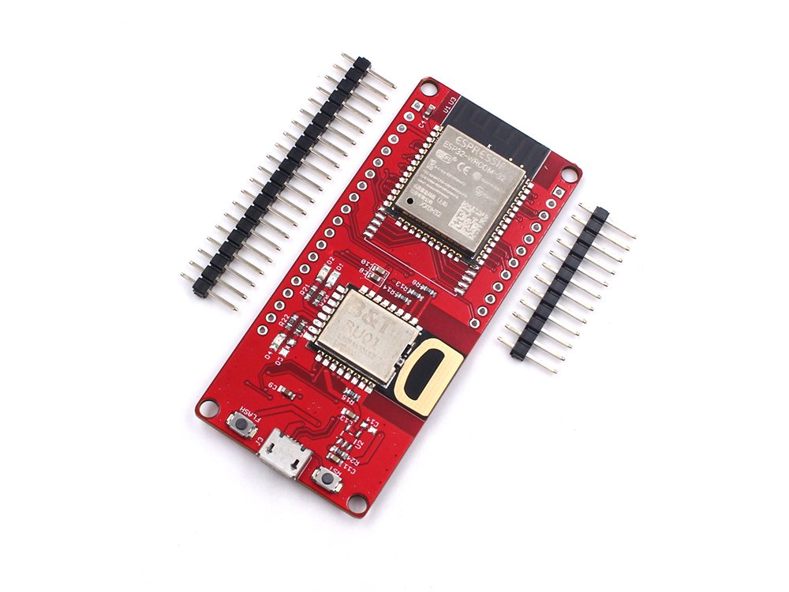

<p align="center">
  
  <br><sub>ESP32 UWB board carrying a DWM1000 &mdash; photo <a href="https://www.makerfabs.com/esp32-uwb-ultra-wideband.html">Makerfabs</a></sub>
</p>

# mcu-uwb

<p align="center">
  
  
  
</p>

A small C UWB transceiver library for **ESP-IDF 5.2+** and **STM32 HAL**.
The Decawave DW1000 keeps its own handle API, double-sided two-way ranging
included, and hands out a `struct uwb_dev`: send and receive frames, and the
hardware timestamps every ranging scheme is built from. This library
replaces `esp-dw1000-uwb`; the STM32 port is new.

The repository is named `mcu-uwb`; the C API, `CONFIG_UWB_*` options and
forge package key are `uwb`. The clone command below names the ESP-IDF
component directory `uwb` as well.

> **Hardware unverified.** Host tests use a simulated DW1000 and platform
> stubs. Nothing here has run on a physical chip.

[Supported hardware](#supported-hardware) · [Install](#install) ·
[Quick start](#quick-start) · [Examples](#examples) ·
[Documentation](#documentation) · [Tests](#tests)

## Supported hardware

| Chip | Interface | Notes |
|---|---|---|
| **DW1000** (DWM1000 module) | SPI mode 0, 2 MHz until the PLL locks, then up to 20 MHz | channels 1–5 and 7, 110 k / 850 k / 6.8 Mbps, PRF 16/64 MHz; 40-bit timestamps of 15.65 ps; four-frame asymmetric double-sided ranging; IRQ pin optional |

Wiring is in the [wiring guide](docs/hardware.md).

## Install

### ESP-IDF

Clone into your project's components directory:

```sh
git clone https://github.com/JonasAtelier/mcu-uwb components/uwb
```

Enable the chip in `idf.py menuconfig` → **Component config → UWB
transceiver subsystem**, or add this to `sdkconfig.defaults`:

```ini
CONFIG_UWB=y
CONFIG_UWB_DW1000=y
```

The `main` component sees the library automatically. Other components declare
`REQUIRES uwb driver` in `idf_component_register()`.

### esp-forge / stm-forge

stm-forge must be at `ee921c3` or later, which builds the chip folders in
`src/`; older ones fail at link with undefined chip functions.

Add to `profiles/pkgversion`:

```make
uwb_GIT=https://github.com/JonasAtelier/mcu-uwb@stable
```

Enable the package and the chip in `configs/<target>_defconfig`:

```make
PKG_uwb             = y
UWB_DW1000          = y
```

### STM32 HAL without forge

Compile every `.c` under `src/`, chip folders included, add `include/` and
`src/` to the include path, and define `CMSIS_device_header` as your family
header, `USE_HAL_DRIVER`, and `CONFIG_UWB_DW1000=1`. The DW1000 needs the
HAL SPI module.

**No chip driver is enabled by default.** See the
[installation guide](docs/installation.md) for all options.

## Quick start

On ESP-IDF, with the SPI bus initialised:

```c
#include "dw1000.h"
#include "dw1000_twr.h"

dw1000_config_t cfg = {
    .host = SPI2_HOST, .cs_gpio = 4, .rst_gpio = 27, .irq_gpio = 34,
    .channel = 5, .rate = DW_RATE_6M8, .prf = DW_PRF_64M,
    .preamble_len = 128, .preamble_code = 9,
    .antenna_delay = 16436,
    .addr = 1,                                   // this tag
};

dw1000_handle_t dw;
ESP_ERROR_CHECK(dw1000_init(&cfg, &dw));

float metres;
if (dw1000_twr_range(dw, 2, &metres) == ESP_OK)  // range to anchor 2
    printf("%.3f m\n", metres);
```

The anchor, configured with `.addr = 2`, runs `dw1000_twr_respond(dw,
&metres, 1000)` in a loop; both ends get the same number. Channel, rate,
PRF, preamble length and preamble code must match on both.

- On the HAL the config takes the app's `SPI_HandleTypeDef *` in mode 0,
  chip select and RSTn port/pin pairs, and an optional `spi_clock` callback
  that switches the handle between slow and fast; see
  [API usage](docs/usage.md).
- On ESP-IDF the chip calls return `esp_err_t`, as esp-dw1000-uwb did; on
  the HAL, **0 or a negative errno**. `uwb_*` is errno on both.
- **Calibrate the antenna delay** before trusting a distance; see
  [the chip reference](docs/chips.md#antenna-delay-calibration).

## Examples

| Chip | ESP-IDF | STM32 HAL |
|---|---|---|
| DW1000 | [dw1000](examples/esp/dw1000/) | [dw1000](examples/stm/dw1000/main.c) |

Both are two-board ranging demos with a `ROLE_INITIATOR` switch: build twice,
flash two boards. ESP-IDF examples locate this library through
`EXTRA_COMPONENT_DIRS`, which assumes the repository is checked out as `uwb`.
With ESP-IDF activated:

```sh
cd examples/esp/dw1000
idf.py set-target esp32 # Replace with your board's target.
idf.py build
```

STM32 examples are snippets to integrate into your application.

## Scope and limitations

- **Standard frames only** (127 bytes). No frame filtering, sleep modes,
  double-buffered RX or TDoA.
- **Standard IEEE 802.15.4 SFD** at every rate.
- **Blocking calls.** A wait sleeps on the IRQ pin if wired, otherwise polls
  `SYS_STATUS`; timeouts are wall-clock.
- **One ranging exchange at a time per radio.** On ESP-IDF each SPI access
  is locked, so other tasks may read timestamps meanwhile; on the HAL there
  is no lock: one caller per device.
- **Preambles of 1536 symbols or more** never fit the ranging reply delay.

## Documentation

| Guide | Contents |
|---|---|
| [Installation](docs/installation.md) | Forge, ESP-IDF, STM32 HAL, build options and logging setup |
| [Hardware](docs/hardware.md) | Pins and wiring, on both platforms |
| [API usage](docs/usage.md) | The handle and the category view, ranging, SPI speed, timing, errors, changes from esp-dw1000-uwb |
| [Chip reference](docs/chips.md) | Ranging, antenna delay calibration, start-up, register provenance against the User Manual |
| [Development](docs/development.md) | Platform ports, bus abstraction, adding a driver and test coverage |

## Tests

```sh
make -C test test
```

Host-only tests use stubbed HAL and ESP-IDF APIs; no embedded toolchain or
physical chip is needed. See the [test reference](docs/development.md#tests).
Error logs during the suite are expected: tests deliberately exercise
failure paths.

## License

[MIT](LICENSE)
